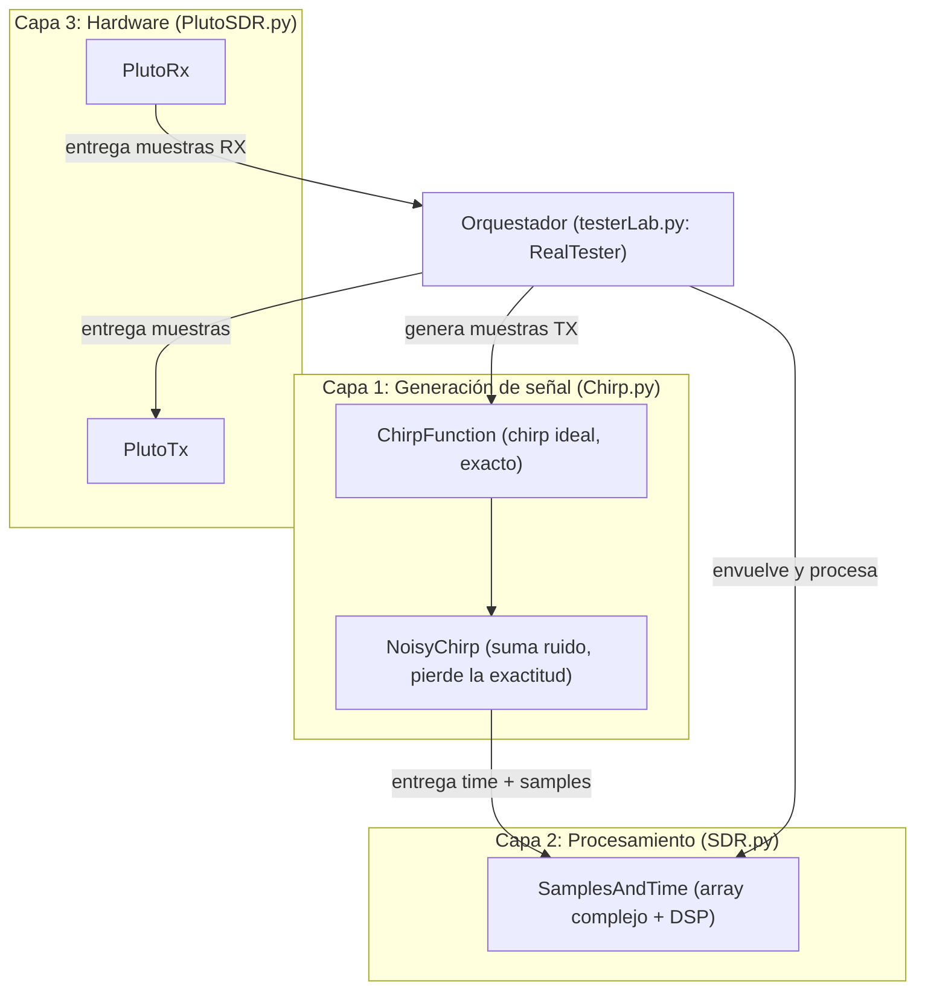
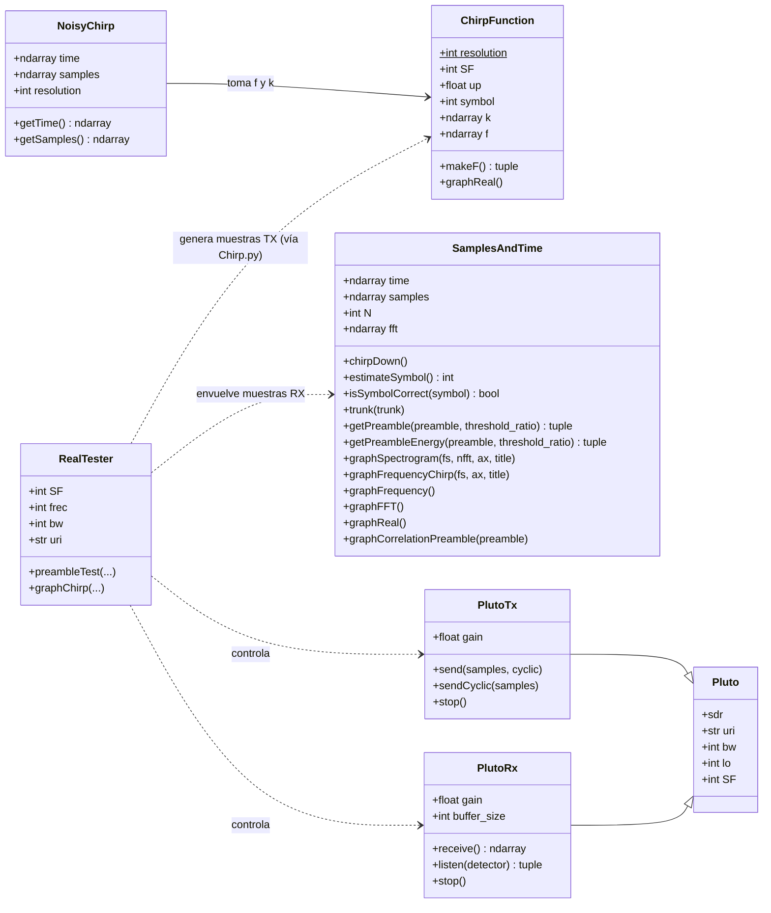

# LoRa-Modulation

**Procesamiento Estocástico de Señales**
Universidad Nacional de Córdoba, Facultad de Ciencias Exactas, Físicas y Naturales (FCEFyN)

Este proyecto implementa en Python una modulación tipo **LoRa (CSS, Chirp Spread Spectrum)** y la prueba por aire con un **ADALM-Pluto** (SDR). Como referencia teórica se tomó el paper de Lorenzo Vangelista, *"Frequency Shift Chirp Modulation: The LoRa Modulation"*, IEEE Signal Processing Letters, vol. 24, n.º 12, diciembre de 2017. Ese trabajo describe LoRa como una **modulación por desplazamiento de frecuencia de chirp (FSCM)**, demuestra la ortogonalidad de las formas de onda y deduce el demodulador óptimo, que se implementa con una FFT.

El diseño está pensado en **capas** que no se conocen entre sí. La sección [Arquitectura](#arquitectura-por-capas) explica por qué.

---

## Índice

- [Fundamento teórico](#fundamento-teórico)
- [Estructura del proyecto](#estructura-del-proyecto)
- [Arquitectura por capas](#arquitectura-por-capas)
- [Diagrama de clases](#diagrama-de-clases)
- [Descripción de los módulos](#descripción-de-los-módulos)
- [Uso](#uso)
- [Hardware: ADALM-Pluto](#hardware-adalm-pluto)
- [Limitaciones conocidas](#limitaciones-conocidas)
- [Próximos pasos](#próximos-pasos)
- [Pruebas](#pruebas)
- [Referencias](#referencias)

---

## Fundamento teórico

Siguiendo a Vangelista, la señal se transmite a una muestra por `T = 1/B`, con `B` el ancho de banda del canal. Cada **símbolo** dura `Ts = 2^SF · T` y toma un valor `s ∈ {0, 1, …, 2^SF − 1}`, formado por `SF` bits (*Spreading Factor*). Con `N = 2^SF`, cada símbolo ocupa `N` muestras (con `resolution = 1`).

**Modulación.** La información está en el **desplazamiento de frecuencia inicial** del chirp. Cada forma de onda es un chirp base desplazado cíclicamente `s` posiciones:

```
c[k] = (1/√N) · exp( j·2π · ((s + k) mod N) · k / N ),   k = 0 … N-1
```

En el código (`ChirpFunction.makeF`):

```
phase = 2π · ((symbol + t) mod N) · t / N
x[t]  = exp(j · up · phase) / √N
```

- `up = +1` genera un upchirp y `up = -1` un downchirp.
- La normalización `1/√N` deja cada símbolo con energía unitaria (potencia `1/N`). Esto importa para relacionar el ruido con el SNR.

**Ortogonalidad.** El paper demuestra que las `N` formas de onda son ortogonales entre sí: el producto interno entre dos símbolos distintos es cero. Por eso el receptor puede decidir proyectando sobre cada una y quedándose con la de mayor módulo.

**Demodulación (dechirp).** Proyectar sobre las `N` formas de onda equivale a dos pasos: multiplicar la señal recibida por el **downchirp** base y calcular la **FFT**. El desplazamiento cíclico se convierte en una frecuencia constante, y el **pico de la FFT** es el símbolo:

```
d[k]    = r[k] · exp(-j·2π·k² / N)
X       = FFT(d) / √N
símbolo = argmax |X|
```

Esto es lo que hace `SamplesAndTime.chirpDown()` y `estimateSymbol()`.

**Hipótesis del paper.** La derivación del receptor óptimo supone **sincronismo perfecto de tiempo y de frecuencia** y canal AWGN. En AWGN, FSCM y FSK de igual cardinalidad rinden lo mismo; en un canal selectivo en frecuencia, FSCM rinde mejor porque cada chirp barre todo el ancho de banda. En la práctica, el sincronismo hay que resolverlo (ver [Limitaciones conocidas](#limitaciones-conocidas)).

**Ruido.** `NoisyChirp` suma ruido gaussiano complejo `σ·(randn + j·randn)`, donde `σ` se pasa directamente como parámetro `noise`. Para obtener un SNR dado en dB, con potencia de señal `1/N`:

```
σ = √( 1 / (2 · N · 10^(SNR/10)) )
```

**Preámbulo.** Estilo LoRa: 8 upchirps (símbolo 0) seguidos de 2,25 downchirps. Sirve para detectar el inicio de la trama por correlación.

---

## Estructura del proyecto

```
src/
├── Chirp.py      # Capa 1: generación de señal (ideal y con ruido)
├── SDR.py        # Capa 2: SamplesAndTime, array complejo + operaciones DSP
├── PlutoSDR.py   # Capa 3: controladores del hardware (Pluto, PlutoTx, PlutoRx)
└── testerLab.py  # Orquestador: RealTester, pruebas por aire
```

---

## Arquitectura por capas

El proyecto sigue una **arquitectura de capas**: el sistema se divide en niveles con una única responsabilidad, y cada nivel se comunica con los demás a través de una interfaz simple y bien definida. Acá la interfaz es un **array de números complejos con su eje de tiempo** (`time` + `samples`). Mientras esa interfaz se respete, cada capa se puede reemplazar o modificar sin que las otras se enteren: por ejemplo, cambiar un Pluto por otro SDR, o cambiar el modelo de ruido.

La regla central: **la capa de procesamiento no conoce a ninguna de las otras, y la capa de hardware no sabe qué señal transmite ni qué busca al recibir.** Solo `testerLab.py`, que orquesta, conoce a todas.



### Capa 1: generación de señal (`Chirp.py`)

Sabe **qué es un chirp**: `SF`, símbolo, dirección. Es la única capa que conoce la teoría de la modulación.

- `ChirpFunction` genera el chirp **ideal**: se sabe exactamente qué símbolo, qué SF y qué fase tiene.
- `NoisyChirp` le suma ruido y devuelve **solo muestras**. Ahí se **pierde la exactitud**: lo que sale ya no es "un chirp de símbolo 5", es un array complejo contaminado.

El resultado de la capa sale empaquetado como `SamplesAndTime`, sin ningún dato extra sobre cómo se generó.

### Capa 2: procesamiento (`SDR.py` → `SamplesAndTime`)

Es **un array de números complejos con un eje de tiempo y métodos**. Nada más.

- **No tiene referencias a `Chirp`.** No sabe qué símbolo se envió, ni qué SF se usó, ni si hay ruido.
- `chirpDown()` puede parecer una dependencia del chirp, pero **es solo una operación matemática** (multiplicar por `exp(-j2π t²/N)` y hacer la FFT) que se aplica a cualquier array de muestras.
- Contiene operaciones puras: dechirp, FFT, estimación de símbolo, frecuencia instantánea, espectrograma, correlación con un preámbulo, gráficos.

### Capa 3: hardware (`PlutoSDR.py`)

Controla el ADALM-Pluto y **no conoce ni `Chirp` ni `SamplesAndTime`**:

- `PlutoTx` recibe un array y lo transmite, aplicando solo la escala del DAC.
- `PlutoRx` entrega el array que captó. Para esperar el preámbulo, `listen(detector)` recibe una **función detectora** inyectada desde afuera: el Pluto no sabe qué se está detectando, lo decide quien lo llama.
- Al objeto `adi.Pluto` se lo pasa ya creado; la URI se toma de él.

### Orquestador (`testerLab.py`)

`RealTester` es la única parte que conoce las tres capas, porque necesita fabricar señales (Capa 1), transmitirlas y recibirlas (Capa 3) y juzgarlas (Capa 2). Es donde está permitido saber qué se envió.

### La ventaja clave: `SamplesAndTime` no distingue una señal simulada de una real

`SamplesAndTime` solo recibe dos cosas al crearse: `time` y `samples`. No guarda ningún dato sobre el origen de la señal (ni símbolo, ni SF, ni nivel de ruido), así que **no tiene forma de saber si las muestras vienen de la simulación o del aire**. En ambos casos el camino termina en la misma línea:

```python
# Simulación (Chirp.py): el chirp ideal + ruido inventado
a = ChirpFunction(SF, symbol, up)
b = NoisyChirp(a, noise)
return SDR.SamplesAndTime(b.time, b.getSamples())

# Aire real (testerLab.py): lo que captó la antena del Pluto
st = SDR.SamplesAndTime(np.arange(len(rx_samples)), rx_samples)
```

```
Chirp.py (simulación) ──► SamplesAndTime(time, samples) ──┐
                                                          ├──► mismo procesamiento
Pluto (aire real)     ──► SamplesAndTime(time, samples) ──┘
```

Lo que se gana con esto:

- **Un solo demodulador para todo.** Lo que se valida en simulación se usa sin cambios sobre la señal recibida por aire.
- **Simulación honesta.** El receptor simulado ve lo mismo que vería uno real: un array complejo sin metadatos, así que no puede "hacer trampa" y los resultados no salen optimistas.

Para que esto se mantenga, `SamplesAndTime` **no debe usar nada de `Chirp`**. La dependencia es solo en un sentido: `Chirp.py` importa `SDR` únicamente para empaquetar su resultado en el `return`.

> **Ojo:** que la clase *procese* igual las dos señales no significa que *funcione* igual. La señal real trae problemas que la simulación no tiene: no saber dónde empieza cada símbolo en el buffer, offset de frecuencia entre equipos (CFO) y distorsiones del hardware y del aire. Ver [Limitaciones conocidas](#limitaciones-conocidas).

### ¿Por qué se hizo así?

**1. Evitar falsas pruebas.** Si el receptor tuviera acceso al `ChirpFunction` original (símbolo, SF, fase), podría "hacer trampa" sin querer. Como `SamplesAndTime` solo ve muestras, **el receptor trabaja con la misma información que tendría con una señal real**.

**2. Una sola ruta de procesamiento para simulación y hardware.** Lo que sale de `NoisyChirp` y lo que sale del Pluto tienen el mismo tipo de dato.

**3. Cada capa se puede probar sola.** La generación se prueba sin hardware, el procesamiento se prueba con señales generadas, y el hardware se prueba con una señal conocida. Si algo falla, se sabe en qué capa mirar.

**4. Cambios localizados.** Cambiar el modelo de ruido toca solo `NoisyChirp`. Cambiar de SDR toca solo `PlutoSDR.py`. Mejorar la detección o el sincronismo toca solo `SamplesAndTime`.

> **Consecuencia directa de este diseño:** `SamplesAndTime` no sabe cuántas muestras tiene un símbolo, solo toma `N = len(samples)`. Por eso `chirpDown` asume **un símbolo por objeto**. Ver [Limitaciones conocidas](#limitaciones-conocidas).

---

## Diagrama de clases



Las funciones de `Chirp.py` (`chirpSeq`, `makeChirpPreamble`, `makeFastChirp`, `chirpFactory`, `makeSilence`) crean `ChirpFunction` y `NoisyChirp` y entregan `SamplesAndTime`; por eso no aparecen como clase.

Observar que **ninguna flecha sale de `SamplesAndTime` hacia `ChirpFunction`, `NoisyChirp` ni las clases del Pluto**, y que **`Pluto`, `PlutoTx` y `PlutoRx` no apuntan a nadie salvo a su herencia**. Esas son las propiedades que protegen el diseño.

---

## Descripción de los módulos

### `Chirp.py`

| Elemento | Qué hace |
| --- | --- |
| `ChirpFunction(SF, symbol, up)` | Chirp ideal de `2^SF` muestras. `k` es el eje de tiempo y `f` las muestras complejas. |
| `NoisyChirp(chirpFunction, noise)` | Suma ruido gaussiano complejo de desvío `noise` a un `ChirpFunction`. |
| `makeFastChirp(SF, symbol, noise, up)` | Atajo: chirp con ruido empaquetado como `SamplesAndTime`. |
| `chirpFactory(N, SF, symbol, noise, up)` | Lista de `N` chirps independientes (cada uno con su ruido). |
| `chirpSeq(SF, symbols, noise, up, startDelay, endDelay)` | Concatena una secuencia de símbolos. Los silencios inicial y final se miden en símbolos. |
| `makeChirpPreamble(SF, noise)` | 8 upchirps + 3 downchirps recortados a 2,25. |
| `makeSilence(length, noise)` | Ruido puro, para simular silencio. |

### `SDR.py` (`SamplesAndTime`)

| Método | Qué hace |
| --- | --- |
| `chirpDown()` | Dechirp + FFT. Se llama sola al construir el objeto. |
| `estimateSymbol()` | Índice del pico de la FFT, es decir el símbolo estimado. |
| `isSymbolCorrect(symbol)` | Compara el símbolo estimado con uno dado. |
| `trunk(n)` | Recorta `n` muestras del final y recalcula la FFT. |
| `getPreamble(preamble, ratio)` | Correlación cruzada (`mode="full"`) con umbral **absoluto**, relativo a la energía del preámbulo. |
| `getPreambleEnergy(preamble, ratio)` | Correlación **normalizada** por la energía de la ventana (`mode="valid"`), con umbral entre 0 y 1. Funciona sobre buffers más largos que el preámbulo y devuelve el desfase del máximo. |
| `graphSpectrogram(fs, nfft, ax, title)` | Espectrograma de las muestras. |
| `graphFrequencyChirp(fs, ax, title)` | Frecuencia instantánea `angle(x[n]·conj(x[n-1]))`. Con `fs` muestra MHz y µs. |
| `graphFrequency()`, `graphFFT()`, `graphReal()` | Gráficos simples de frecuencia, FFT y parte real. |
| `graphCorrelationPreamble(preamble)` | Grafica la correlación y el desfase del máximo. |

### `PlutoSDR.py`

| Elemento | Qué hace |
| --- | --- |
| `Pluto(sdr, bw, lo, SF)` | Base común. Recibe el `adi.Pluto` ya creado, toma su `uri` y fija el `sample_rate` en `bw`. |
| `PlutoTx(sdr, bw, gain, SF, lo)` | Configura `tx_lo`, ancho de banda y ganancia (rango -89,75 a 0 dB). |
| `PlutoTx.send(samples, cyclic)` | Transmite aplicando `SCALE`. Con `cyclic=True` repite hasta `stop()`. |
| `PlutoTx.sendCyclic(samples)` | Repite el arreglo 4 veces antes de enviar (ver [Hardware](#hardware-adalm-pluto)). |
| `PlutoTx.stop()` | Destruye el buffer TX y corta la transmisión cíclica. |
| `PlutoRx(sdr, bw, gain, SF, lo, buffer_size)` | Configura `rx_lo`, ancho de banda, ganancia manual (0 a 73 dB) y tamaño del buffer (por defecto `2**11`). |
| `PlutoRx.receive()` | Descarta el primer buffer y devuelve el siguiente. |
| `PlutoRx.listen(detector)` | Lee buffers hasta que `detector(rx_samples)` devuelva `(True, lag)`; retorna `(rx_samples, lag)`. |
| `PlutoRx.stop()` | Destruye el buffer RX. |

### `testerLab.py` (`RealTester`)

Parámetros por defecto: `SF=8`, portadora 2,4 GHz, `bw` 1 MHz, `uri="ip:192.168.1.35"`.

- `preambleTest(tx_gain, rx_gain, threshold_ratio, buffer_size, window)`: **test del preámbulo real**. Con un solo Pluto (TX y RX sobre el mismo dispositivo), transmite el preámbulo en forma cíclica, espera con `listen` a detectarlo y grafica el espectrograma y la frecuencia instantánea de lo recibido. Libera los buffers en un `finally`.
- `graphChirp(tx_gain, rx_gain, buffer_size, window)`: transmite el preámbulo, captura un buffer y grafica su espectrograma.
- Helpers internos: `_sendChirp` (secuencia de símbolos), `_sendPreamble` (preámbulo, grafica el teórico) y `_preambleDetector` (arma la función detectora que se inyecta en `PlutoRx.listen`).

---

## Uso

### Requisitos

```
numpy
matplotlib
scipy
pyadi-iio   # importado por testerLab.py; necesario para la parte de hardware
```

### Modulación y demodulación

Ejemplo mínimo: modular una secuencia sin ruido y demodularla cortando en bloques de `2^SF`.

```python
import numpy as np
import Chirp
import SDR

SF = 5
M = 2 ** SF
symbols = [0, 22, 31, 21]

# Capa 1: generar la señal
seq = Chirp.chirpSeq(SF, symbols, noise=0.0, up=1.0, startDelay=0, endDelay=0)

# Capa 2: cortar en bloques de 2^SF y demodular
decoded = []
for i in range(len(symbols)):
    block = seq.samples[i * M:(i + 1) * M]
    decoded.append(int(SDR.SamplesAndTime(np.arange(M), block).estimateSymbol()))

print(decoded)  # [0, 22, 31, 21]
```

### Detección de preámbulo en un buffer largo

```python
import numpy as np
import Chirp
import SDR

SF = 8
M = 2 ** SF
noise = 0.05

preamble = Chirp.makeChirpPreamble(SF, 0.0)        # referencia sin ruido
rx_pre   = Chirp.makeChirpPreamble(SF, noise)      # lo que "llega", con ruido
silence  = Chirp.makeSilence(3 * M, noise)

rx = np.concatenate([silence, rx_pre.samples, silence])
st = SDR.SamplesAndTime(np.arange(len(rx)), rx)

found, lag = st.getPreambleEnergy(preamble, threshold_ratio=0.5)
print(found, lag)  # True, y el desfase debería caer en 3 * M
```

### Prueba por aire (preámbulo real)

```bash
uv run src/testerLab.py
```

Ejecuta `RealTester().preambleTest(tx_gain=-65, threshold_ratio=0.6)`. Antes de correr, revisar la `uri` del Pluto en `RealTester` (por defecto `ip:192.168.1.35`).

---

## Hardware: ADALM-Pluto

Parámetros usados en las pruebas:

| Parámetro | Valor |
| --- | --- |
| Portadora (`rx_lo` / `tx_lo`) | 2,4 GHz |
| Sample rate = ancho de banda | 1 MHz |
| SF | 8 |
| Ganancia TX | -65 dB en `__main__` (por defecto de `preambleTest`: -10 dB; rango -89,75 a 0) |
| Ganancia RX | 40 dB, modo manual (rango 0 a 73) |
| Buffer RX | `2**15` muestras en `preambleTest` |
| Conexión | `ip:<dirección>` (los Plutos se acceden por red/VPN) |

Puntos a tener en cuenta:

- **Escala del DAC.** `SCALE = 2**13 * sqrt(2**8)`. Como las muestras tienen amplitud `1/√N`, con `SF = 8` quedan con amplitud `2**13`. La constante tiene el `SF = 8` fijo, así que con otro `SF` la amplitud transmitida cambia.
- **Buffer cíclico.** Con `cyclic=True` el Pluto repite el buffer indefinidamente. Hay que llamar a `stop()` al terminar y conviene usar `try/finally`, como en `preambleTest`. El equipo y el uso del espectro son responsabilidad de quien lo opera.
- **Repetición del buffer.** El Pluto repite solo el primer cuarto del buffer, por lo que `sendCyclic` lo replica 4 veces como solución.
- **Primer buffer de RX.** Se descarta, porque puede contener datos viejos.
- **Loopback.** En `preambleTest`, TX y RX usan el mismo `adi.Pluto`, así que comparten oscilador local y no hay CFO entre dos equipos.

---

## Limitaciones conocidas

1. **`SamplesAndTime` asume un símbolo por objeto.** `chirpDown` usa `N = len(samples)` como si fuera `2^SF`. Con una secuencia, un preámbulo o un buffer del Pluto, `N` no coincide y el dechirp no sirve. Es una consecuencia del diseño de capas (la clase no conoce el SF). **Solución de uso:** cortar en bloques de `2^SF` muestras, con el tiempo reiniciado en 0 en cada bloque.
2. **Sin corrección de CFO.** Entre dos Plutos distintos habría offset de frecuencia que desplaza los símbolos. La prueba actual usa un solo Pluto, donde no aparece.
3. **Solo se detecta el preámbulo.** Falta demodular una trama completa (preámbulo + datos) a partir del `lag` encontrado.
4. **`SCALE` depende de `SF = 8`** (ver [Hardware](#hardware-adalm-pluto)).
5. **`graphChirp` no detiene la transmisión.** A diferencia de `preambleTest`, no usa `try/finally` ni llama a `tx.stop()`, por lo que el Pluto sigue emitiendo en forma cíclica.
6. **Limpieza pendiente:**
   - `Chirp.py`: `import matplotlib as plt` debería ser `import matplotlib.pyplot as plt`; `graphPhase` y `graphFrec` usan `self.phase` y `self.frec`, que no existen.
   - `SDR.py`: tiene imports accidentales (`json.decoder.NaN`, `scipy.stats.false_discovery_control`); el método `SamplesAndTime()` tiene el mismo nombre que la clase y duplica a `graphReal`; `displaceTime` usa `self.k`, que no existe en `SamplesAndTime`.
   - `testerLab.py`: importa `adi` al inicio, por lo que hace falta `pyadi-iio` instalado incluso para usar solo la parte de simulación de las otras capas.
7. **Nombre de `SDR.py`.** Contiene `SamplesAndTime`, que no es hardware. Un nombre como `samples.py` evitaría confundirlo con la Capa 3 (`PlutoSDR.py`).

---

## Próximos pasos

- [ ] Función `demodulate(samples, SF, start)` que corte en bloques desde el `lag` y decodifique.
- [ ] Estimación y corrección de CFO.
- [ ] Recepción por aire de una trama completa (preámbulo + datos), idealmente entre dos Plutos.
- [ ] Hacer que `SCALE` dependa de `SF`.
- [ ] Agregar `try/finally` a `graphChirp`.
- [ ] Limpiar imports y métodos rotos en `Chirp.py` y `SDR.py`.

---

## Pruebas

### 1. Preámbulo teórico

Espectrograma del preámbulo generado por `makeChirpPreamble` (8 upchirps + 2,25 downchirps), tal como lo grafica `_sendPreamble` (`title="Theorical"`).


### 2. Preámbulo real recibido por aire

Test `RealTester.preambleTest`: un Pluto transmite el preámbulo en forma cíclica y el receptor espera hasta detectarlo con `getPreambleEnergy`.

```bash
uv run src/testerLab.py   # preambleTest(tx_gain=-65, threshold_ratio=0.6)
```

Espectrograma de la ventana recibida:


Frecuencia instantánea del buffer recibido (`graphFrequencyChirp`):


### 3. Captura de un chirp (`graphChirp`)

Espectrograma de un buffer capturado con `nfft=128`.


---

## Referencias

- L. Vangelista, "Frequency Shift Chirp Modulation: The LoRa Modulation," *IEEE Signal Processing Letters*, vol. 24, no. 12, pp. 1818–1821, Dec. 2017.