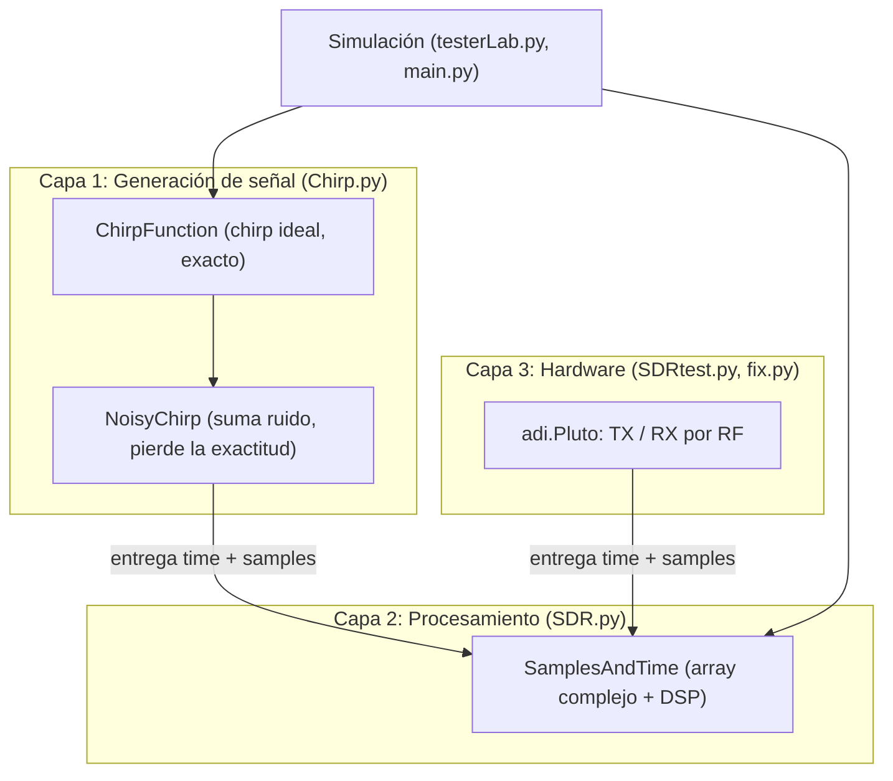

# LoRa-Modulation

Implementación en Python de una modulación tipo **LoRa (CSS, Chirp Spread Spectrum)**, con dos objetivos:

1. **Simular** la modulación y demodulación, y medir el error contra el SNR (Monte Carlo).
2. **Transmitir y recibir por aire** con dos **ADALM-Pluto** (SDR), usando las mismas herramientas de procesamiento que en la simulación.

El diseño está pensado en **capas** que no se conocen entre sí. La sección [Arquitectura](#arquitectura-por-capas) explica por qué.

---

## Índice

- [Fundamento teórico](#fundamento-teórico)
- [Estructura del proyecto](#estructura-del-proyecto)
- [Arquitectura por capas](#arquitectura-por-capas)
- [Diagrama de clases](#diagrama-de-clases)
- [Descripción de los módulos](#descripción-de-los-módulos)
- [Uso](#uso)
- [Hardware: ADALM-Pluto](#hardware-adalm-pluto)
- [Limitaciones conocidas](#limitaciones-conocidas)
- [Próximos pasos](#próximos-pasos)

---

## Fundamento teórico

En CSS, cada **símbolo** es un chirp: una señal cuya frecuencia barre linealmente todo el ancho de banda. Con factor de ensanchamiento `SF`, un símbolo dura `N = 2^SF` muestras (con `resolution = 1`) y puede tomar `N` valores distintos (`0 … N-1`).

**Modulación.** El valor del símbolo es un **desplazamiento cíclico** de la frecuencia inicial del chirp base. En el código:

```
phase = 2π · ((symbol + t) mod N) · t / N
x[t]  = exp(j · up · phase) / √N
```

- `up = +1` genera un upchirp, `up = -1` un downchirp.
- La normalización `1/√N` hace que la potencia de la señal sea `1/N`. Esto importa para calcular el ruido a partir del SNR.

**Demodulación (dechirp).** Se multiplica la señal recibida por el chirp base conjugado y se hace la FFT. El desplazamiento cíclico se convierte en una frecuencia constante, y el **pico de la FFT** es el símbolo:

```
d[t] = x[t] · exp(-j·2π·t² / N)
X    = FFT(d) / √N
símbolo = argmax |X|
```

**Ruido.** Para un SNR dado en dB, con potencia de señal `1/N`:

```
σ = √( 1 / (2 · N · 10^(SNR/10)) )
```

y se suma ruido gaussiano complejo `σ·(randn + j·randn)`.

**Preámbulo.** Estilo LoRa: 8 upchirps (símbolo 0) seguidos de 2,25 downchirps. Sirve para detectar el inicio de la trama por correlación.

---

## Estructura del proyecto

```
src/
├── Chirp.py       # Capa 1: generación de señal (ideal y con ruido)
├── SDR.py         # Capa 2: SamplesAndTime, array complejo + operaciones DSP
├── testerLab.py   # Simulación: VirtualTester (BER / SER vs SNR)
├── main.py        # Tests y experimentos de simulación
├── SDRtest.py     # Capa 3: pruebas por aire con el ADALM-Pluto
└── fix.py         # Chequeo rápido de conectividad con un Pluto
```

---

## Arquitectura por capas

El proyecto sigue una **arquitectura de capas**: el sistema se divide en niveles con una única responsabilidad, y cada nivel se comunica con los demás a través de una interfaz simple y bien definida. Acá la interfaz es un **array de números complejos con su eje de tiempo** (`time` + `samples`). Mientras esa interfaz se respete, cada capa se puede reemplazar o modificar sin que las otras se enteren: por ejemplo, cambiar el canal simulado (`NoisyChirp`) por el aire real, o un Pluto por otro SDR.

Es una separación de responsabilidades propia de las arquitecturas por capas de software, aplicada a la cadena de procesamiento de una señal: las capas se apilan y cada una depende solo de la que tiene debajo.

La regla central: **cada capa solo conoce a la que tiene debajo, y la capa de procesamiento no conoce a ninguna de las otras.**



### Capa 1: generación de señal (`Chirp.py`)

Sabe **qué es un chirp**: `SF`, símbolo, dirección. Es la única capa que conoce la teoría de la modulación.

- `ChirpFunction` genera el chirp **ideal**: se sabe exactamente qué símbolo, qué SF y qué fase tiene.
- `NoisyChirp` le suma ruido y devuelve **solo muestras**. Ahí se **pierde la exactitud**: lo que sale ya no es "un chirp de símbolo 5", es un array complejo contaminado.

El resultado de la capa sale empaquetado como `SamplesAndTime`, sin ningún dato extra sobre cómo se generó.

### Capa 2: procesamiento (`SDR.py` → `SamplesAndTime`)

Es **un array de números complejos con un eje de tiempo y métodos**. Nada más.

- **No tiene referencias a `Chirp`.** No sabe qué símbolo se envió, ni qué SF se usó, ni si hay ruido.
- `chirpDown()` puede parecer una dependencia del chirp, pero **es solo una operación matemática** (multiplicar por `exp(-j2π t²/N)` y hacer la FFT) que se aplica a cualquier array de muestras.
- Contiene operaciones puras: dechirp, FFT, estimación de símbolo, frecuencia instantánea, correlación con un preámbulo, gráficos.

### Capa 3: hardware (`SDRtest.py`, `fix.py`)

Es la comunicación con el SDR (`adi.Pluto`). Lo que recibe del aire es un **array complejo**, así que se lo envuelve en `SamplesAndTime` y se procesa con exactamente las mismas herramientas que en la simulación. Para transmitir, usa la Capa 1 para generar las muestras.

### Simulación (`testerLab.py`, `main.py`)

Es la única parte que conoce las dos capas, porque necesita fabricar señales (Capa 1) y juzgarlas (Capa 2). Aquí sí está permitido saber qué símbolo se envió, porque es quien compara.

### La ventaja clave: `SamplesAndTime` no distingue una señal simulada de una real

`SamplesAndTime` solo recibe dos cosas al crearse: `time` y `samples`. No guarda ningún dato sobre el origen de la señal (ni símbolo, ni SF, ni nivel de ruido), así que **no tiene forma de saber si las muestras vienen de la simulación o del aire**. En ambos casos el camino termina en la misma línea:

```python
# Simulación (Chirp.py): el chirp ideal + ruido inventado
a = ChirpFunction(SF, symbol, up)
b = NoisyChirp(a, noise)
return SDR.SamplesAndTime(b.time, b.getSamples())

# Aire real (SDRtest.py): lo que captó la antena del Pluto
rx_samples = sdr.rx()
st = SamplesAndTime(time, rx_samples)
```

```
Chirp.py (simulación) ──► SamplesAndTime(time, samples) ──┐
                                                          ├──► mismo procesamiento
Pluto (aire real)     ──► SamplesAndTime(time, samples) ──┘
```

Lo que se gana con esto:

- **Un solo demodulador para todo.** Lo que se valida en simulación se usa sin cambios sobre la señal recibida por aire.
- **Simulación honesta.** El receptor simulado ve lo mismo que vería uno real: un array complejo sin metadatos, así que no puede "hacer trampa" y los resultados de error no salen optimistas.

Para que esto se mantenga, `SamplesAndTime` **no debe usar nada de `Chirp`** (ni importarlo para consultar qué símbolo se envió). La dependencia es solo en un sentido: `Chirp.py` importa `SDR` únicamente para empaquetar su resultado en el `return`.

> **Ojo:** que la clase *procese* igual las dos señales no significa que *funcione* igual. La señal real trae problemas que la simulación no tiene: offset de frecuencia entre los dos Plutos (CFO), no saber dónde empieza cada símbolo en el buffer, y distorsiones del hardware y del aire. Ver [Limitaciones conocidas](#limitaciones-conocidas).

### ¿Por qué se hizo así?

**1. Evitar falsas pruebas.** Si el receptor tuviera acceso al `ChirpFunction` original (símbolo, SF, fase), podría "hacer trampa" sin querer y los resultados de BER/SER serían optimistas. Como `SamplesAndTime` solo ve muestras, **el receptor simulado trabaja con la misma información que tendría con una señal real**: un array complejo, sin metadatos.

**2. Una sola ruta de procesamiento para simulación y hardware.** Lo que sale de `NoisyChirp` y lo que sale del Pluto tienen el mismo tipo de dato. Un demodulador validado en simulación se puede usar sobre la señal recibida por aire sin cambiar una línea.

**3. Cada capa se puede probar sola.** `test2` en `main.py` prueba el par modulación/demodulación sin ruido. Los experimentos de BER/SER prueban el receptor frente al ruido. Las pruebas por aire prueban el hardware. Si algo falla, se sabe en qué capa mirar.

**4. Cambios localizados.** Cambiar el modelo de ruido toca solo `NoisyChirp`. Cambiar de SDR toca solo la Capa 3. Mejorar el sincronismo toca solo `SamplesAndTime`.

> **Consecuencia directa de este diseño:** `SamplesAndTime` no sabe cuántas muestras tiene un símbolo, solo toma `N = len(samples)`. Por eso asume **un símbolo por objeto**. Ver [Limitaciones conocidas](#limitaciones-conocidas).

---

## Diagrama de clases

```mermaid
classDiagram
    direction LR

    class ChirpFunction {
        +int resolution$
        +int SF
        +float up
        +int symbol
        +ndarray k
        +ndarray f
        +makeF() tuple
    }

    class NoisyChirp {
        +ndarray time
        +ndarray samples
        +int resolution
        +getTime() ndarray
        +getSamples() ndarray
    }

    class ChirpFactory {
        <>        +makeFastChirp(SF, symbol, noise, up) SamplesAndTime        +chirpFactory(N, SF, symbol, noise, up) list        +chirpSeq(SF, symbols, noise, up, startDelay, endDelay) SamplesAndTime        +makeChirpPreamble(SF, noise) SamplesAndTime        +makeSilence(length, noise) ndarray    }    class SamplesAndTime {        +ndarray time        +ndarray samples        +int N        +ndarray fft        +chirpDown()        +estimateSymbol() int        +isSymbolCorrect(symbol) bool        +trunk(trunk)        +getPreamble(preamble, threshold_ratio) tuple        +getPreambleEnergy(preamble, threshold_ratio) tuple        +graphFrequencyChirp(fs, ax, title)        +graphFrequency()        +graphFFT()        +graphReal()        +graphCorrelationPreamble(preamble)    }    class VirtualTester {        +list functions        +int sent        +int SF        +getBER() float        +getSER(threshold) float        +graphBer()        +graphSER(threshold)    }    class Pluto {        <>        +rx() ndarray        +tx(samples)        +tx_cyclic_buffer        +tx_destroy_buffer()        +rx_destroy_buffer()    }    class SDRtest {        <><span class="ag-soft-line-break"></span>        +send()<span class="ag-soft-line-break"></span>        +recive()<span class="ag-soft-line-break"></span>        +stop()<span class="ag-soft-line-break"></span>        +test_chirp(...)<span class="ag-soft-line-break"></span>    }<span class="ag-soft-line-break"></span><span class="ag-soft-line-break"></span>    NoisyChirp --> ChirpFunction : toma f y k<span class="ag-soft-line-break"></span>    ChirpFactory ..> ChirpFunction : crea<span class="ag-soft-line-break"></span>    ChirpFactory ..> NoisyChirp : crea<span class="ag-soft-line-break"></span>    ChirpFactory ..> SamplesAndTime : entrega solo time + samples<span class="ag-soft-line-break"></span>    VirtualTester o-- SamplesAndTime : evalúa N señales<span class="ag-soft-line-break"></span>    VirtualTester ..> ChirpFactory : fabrica señales<span class="ag-soft-line-break"></span>    SDRtest ..> Pluto : controla<span class="ag-soft-line-break"></span>    SDRtest ..> ChirpFactory : genera muestras TX<span class="ag-soft-line-break"></span>    SDRtest ..> SamplesAndTime : envuelve muestras RX</code>
```

Observar que **ninguna flecha sale de `SamplesAndTime` hacia `ChirpFunction`, `NoisyChirp` ni `Pluto`**. Esa es la propiedad que protege el diseño.

---

## Descripción de los módulos

### `Chirp.py`

| Elemento | Qué hace |
| --- | --- |
| `ChirpFunction(SF, symbol, up)` | Chirp ideal de `2^SF` muestras. `k` es el eje de tiempo y `f` las muestras complejas. |
| `NoisyChirp(chirpFunction, noise)` | Suma ruido gaussiano complejo de desvío `noise` a un `ChirpFunction`. |
| `makeFastChirp(SF, symbol, noise, up)` | Atajo: chirp con ruido empaquetado como `SamplesAndTime`. |
| `chirpFactory(N, SF, symbol, noise, up)` | Lista de `N` chirps independientes (cada uno con su ruido) para Monte Carlo. |
| `chirpSeq(SF, symbols, noise, up, startDelay, endDelay)` | Concatena una secuencia de símbolos. Los silencios inicial y final se miden en símbolos. |
| `makeChirpPreamble(SF, noise)` | 8 upchirps + 3 downchirps recortados a 2,25. |
| `makeSilence(length, noise)` | Ruido puro, para simular silencio. |

### `SDR.py` (`SamplesAndTime`)

| Método | Qué hace |
| --- | --- |
| `chirpDown()` | Dechirp + FFT. Se llama sola al construir el objeto. |
| `estimateSymbol()` | Índice del pico de la FFT, es decir el símbolo estimado. |
| `isSymbolCorrect(symbol)` | Compara el símbolo estimado con uno dado. |
| `trunk(n)` | Recorta `n` muestras del final y recalcula la FFT. |
| `getPreamble(preamble, ratio)` | Correlación cruzada con umbral **absoluto** (relativo a la energía del preámbulo). |
| `getPreambleEnergy(preamble, ratio)` | Correlación **normalizada** por la energía de la ventana, con umbral entre 0 y 1. |
| `graphFrequencyChirp(...)` | Frecuencia instantánea `angle(x[n]·conj(x[n-1]))`. Con `fs` muestra MHz y µs. |
| `graphCorrelationPreamble(preamble)` | Grafica la correlación y el desfase del máximo. |

### `testerLab.py` (`VirtualTester`)

- `getBER()`: dechirp de cada señal y proporción que no da el símbolo enviado. En rigor es una **tasa de error de símbolo**, no de bit.
- `graphBer()`: barre SNR de -30 a -11 dB y grafica en escala semilog.
- `getSER(threshold)`: proporción de señales donde **no se detecta** el preámbulo.
- `graphSER(threshold)`: SER de detección de preámbulo contra SNR, de -30 a 5 dB.

### `main.py`

Tests y experimentos:

- `test1`, `test3`: tasa de error con chirps ruidosos.
- `test2`: sin ruido, los `2^SF` símbolos se decodifican bien.
- `test4`: verifica que `chirpDown` decodifica bien con un símbolo por objeto, que falla con una secuencia completa de golpe, y que cortando en bloques de `2^SF` se recupera la secuencia.

### `SDRtest.py`

- `send()`: activa el buffer cíclico y transmite una secuencia (SF=5, símbolos `[0, 22, 41, 21]`).
- `recive()`: descarta el primer buffer, lee otro y grafica la frecuencia instantánea.
- `stop()`: destruye los buffers TX y RX.
- `test_chirp(...)`: versión parametrizada con `try/finally` que compara espectrogramas de lo generado contra lo recibido.

### `fix.py`

Conecta a un Pluto, lee un buffer e imprime su largo y las primeras muestras. Sirve para verificar la conexión.

---

## Uso

### Requisitos

```
numpy
matplotlib
scipy
pyadi-iio   # solo para la parte de hardware
```

### Simulación

```bash
uv run src/main.py
```

Ejemplo mínimo: modular, agregar ruido y demodular.

```python
import numpy as np
import Chirp
import SDR

SF = 5
M = 2 ** SF
symbols = [0, 22, 31, 21]

# Capa 1: generar la señal (con ruido)
seq = Chirp.chirpSeq(SF, symbols, noise=0.0, up=1.0, startDelay=0, endDelay=0)

# Capa 2: cortar en bloques de 2^SF y demodular
decoded = []
for i in range(len(symbols)):
    block = seq.samples[i * M:(i + 1) * M]
    decoded.append(int(SDR.SamplesAndTime(np.arange(M), block).estimateSymbol()))

print(decoded)  # [0, 22, 31, 21]
```

### Curva de detección de preámbulo

```python
import Chirp, testerLab

SF = 4
f = Chirp.makeChirpPreamble(SF, 0.0)
tester = testerLab.VirtualTester([f] * 100, 2, SF)
tester.graphSER(0.25)
```

---

## Hardware: ADALM-Pluto

Parámetros usados en las pruebas:

| Parámetro | Valor |
| --- | --- |
| Portadora (`rx_lo` / `tx_lo`) | 2,4 GHz |
| Sample rate = ancho de banda | 1 MHz (`SDRtest.py`), 2,5 MHz (`fix.py`) |
| Ganancia TX | -30 dB (rango -89,75 a 0) |
| Ganancia RX | 40 dB, modo manual (rango 0 a 73) |
| Conexión | `ip:<dirección>` (los Plutos se acceden por red/VPN) |

Puntos a tener en cuenta:

- **Escala del DAC.** El Pluto espera muestras de tipo int16, por eso las muestras (amplitud ~`1/√N`) se multiplican por `2**14` antes de transmitir.
- **Buffer cíclico.** Con `tx_cyclic_buffer = True` el Pluto repite el buffer indefinidamente. Hay que llamar a `tx_destroy_buffer()` al terminar. Conviene usar `try/finally`, como en `test_chirp`.
- **Primer buffer de RX.** Se descarta, porque puede contener datos viejos.

---

## Limitaciones conocidas

1. **`SamplesAndTime` asume un símbolo por objeto.** `chirpDown` usa `N = len(samples)` como si fuera `2^SF`. Con una secuencia, un preámbulo o un buffer del Pluto, `N` no coincide y el dechirp no sirve. Es una consecuencia del diseño de capas (la clase no conoce el SF). **Solución de uso:** cortar en bloques de `2^SF` muestras, con el tiempo reiniciado en 0 en cada bloque.
2. **El SER mide detección con sincronismo perfecto.** `getPreambleEnergy` usa `mode="valid"` sobre señales del mismo largo que el preámbulo, así que solo evalúa un desfase. No mide la búsqueda de timing en un buffer largo.
3. **Sin sincronismo ni corrección de CFO en la recepción real.** Entre dos Plutos hay offset de frecuencia que desplaza los símbolos. Falta ubicar el inicio de la trama y corregirlo.
4. **`getBER` es en realidad SER.** Cuenta símbolos erróneos, no bits.
5. **Símbolo fuera de rango en `SDRtest.py`.** Con SF=5 los símbolos válidos son 0 a 31, pero se envía 41 (equivale a 9 por el `% N`).
6. **Limpieza pendiente en `Chirp.py` y `SDR.py`:**
  - `import matplotlib as plt` debería ser `import matplotlib.pyplot as plt`.
  - `graphPhase` y `graphFrec` usan `self.phase` y `self.frec`, que no existen.
  - `SDR.py` tiene imports accidentales (`json.decoder.NaN`, `scipy.stats.false_discovery_control`).
  - `SDR.py` se importa a sí mismo (`import SDR as SDR`) y tiene un `import Chirp as CP` sin uso. Eliminarlo refuerza el desacople de capas.
  - `displaceTime` usa `self.k`, que no existe en `SamplesAndTime`.
  - `main.py` llama a `SDR.Tester`, que no existe (debería ser `testerLab.VirtualTester`), en `test1` y `test3`.
7. **Nombre de `SDR.py`.** Contiene `SamplesAndTime`, que no es hardware. Un nombre como `samples.py` evitaría confundirlo con la Capa 3.

---

## Próximos pasos

- [ ] Función `demodulate(samples, SF, start)` que corte en bloques y decodifique.
- [ ] Sincronización con el preámbulo sobre buffers largos (búsqueda de timing).
- [ ] Estimación y corrección de CFO.
- [ ] Recepción por aire de una trama completa (preámbulo + datos) entre dos Plutos.
- [ ] Renombrar `getBER` a `getSER` y agregar una BER real si se codifican bits.
- [ ] Mover el código suelto de `main.py` y `SDRtest.py` bajo `if __name__ == "__main__":`.
